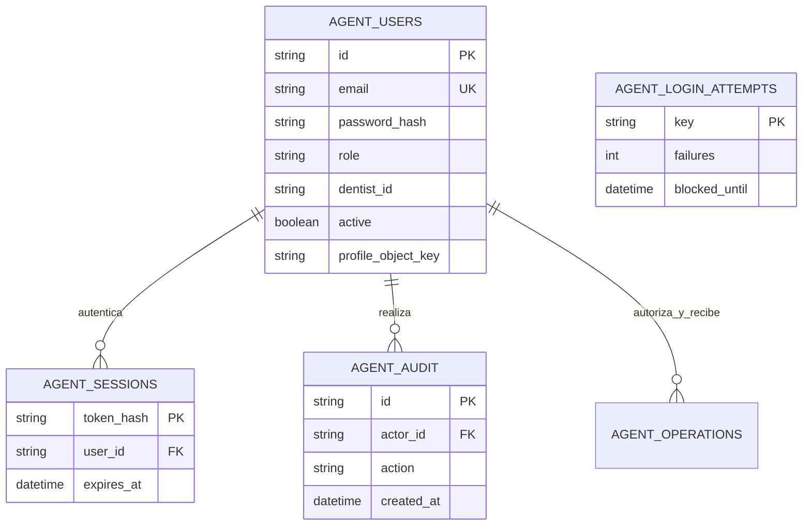

# Primer entregable del agente de DentalRisk

**Nota de versión:** este documento describe v01 con base independiente. La instalación local posterior unificó identidades y registros en `dentalrisk`; consultar [README](../README.md) y [Estado de verificación](../evidence/ESTADO.md) para el estado vigente.

**Proyecto:** asistente operativo para el monitoreo de productividad en una clínica dental.

**Versión:** 0.1.1. **Rama:** v01. **Fecha:** 26 de octubre de 2026.

## Propósito y alcance

El agente ayudará al dueño de la clínica a entender los indicadores de pacientes atendidos, duración de servicios, tiempos sin atención y valor de los servicios completados. Su función será explicar información autorizada y apoyar el seguimiento administrativo. La asignación de citas y tarjetas corresponde a recepción. El agente no sustituirá al personal ni emitirá diagnósticos.

Esta primera parte implementa un proyecto independiente al que se conecta el agente de IA que ya existe en el ESP. El usuario puede pedirle que cree una cuenta y después enviarle su foto. El agente llama a la API con JSON; el servidor lee el adjunto del ESP, guarda la imagen en MinIO y la vincula con la cuenta. Se incluyen el modelo User, el hash de contraseñas, tokens revocables y una credencial delegada para el dispositivo. La consulta de indicadores de la aplicación principal sigue fuera de este alcance.

## Tecnologías y justificación

| Tecnología | Aplicación y motivo |
| --- | --- |
| Python 3.12 y FastAPI | API modular con validación de entradas, dependencias de seguridad y documentación OpenAPI. Permite trabajar la integración del agente en Python. |
| SQLModel y SQLAlchemy | Modelos tipados y sesiones transaccionales. Las restricciones únicas, las claves foráneas y las reglas de rol también se aplican en la base. |
| PostgreSQL | Motor previsto para el servicio desplegado. Conserva usuarios, sesiones, intentos y auditoría; permite bloquear la fila de intentos durante el inicio de sesión concurrente. |
| SQLite | Facilita el primer arranque y las pruebas rápidas. No se presenta como equivalente de producción ni se usa para validar la concurrencia de PostgreSQL. |
| Alembic | Versiona el esquema. La API no crea ni modifica tablas al iniciar; primero se ejecuta `alembic upgrade head`. |
| Argon2id | Protege contraseñas mediante un hash con sal aleatoria y costo de memoria. La contraseña original no se almacena ni se devuelve. |
| PyJWT y Bearer | Firma y valida tokens de duración limitada. Se verifica además una sesión persistida para permitir revocación inmediata. |
| MinIO y Boto3 | Archivos en almacenamiento de objetos compatible con S3, separado de la base relacional. Los perfiles permanecen privados y se entregan mediante la API autenticada. |
| Pillow | Comprueba el contenido real de cada imagen, limita sus dimensiones y genera una copia JPEG sin conservar metadatos del archivo original. |
| Docker Compose | Separa PostgreSQL, MinIO, migración y API. Los puertos de desarrollo se enlazan a loopback y los datos usan volúmenes independientes. |
| Pytest y HTTPX | Pruebas reproducibles de permisos, autenticación y errores. HTTPX también descarga de forma limitada los adjuntos del ESP. |

Las versiones efectivamente instaladas quedan fijadas en `requirements.lock.txt`; `requirements.txt` declara las dependencias directas. La auditoría de paquetes y la evidencia de ejecución se conservan por separado de los secretos.

## Modelo de datos

El servicio utiliza cinco tablas. No copia pacientes, citas ni registros de atención de la aplicación principal.

| Modelo | Campos principales | Reglas |
| --- | --- | --- |
| User / agent_users | id, name, email, password_hash, role, dentist_id, active, profile_object_key, created_at | Correo único normalizado a minúsculas. Roles ADMIN, RECEPTION, DENTIST y SUPPORT. DENTIST requiere referencia a dentista. La respuesta incluye profile_pic con la URL autenticada de consulta, sin hash de contraseña ni clave S3. |
| TokenSession / agent_sessions | token_hash, user_id, expires_at | Relación con User. Guarda SHA-256 del token, nunca el Bearer original. Se elimina al cerrar sesión y al cambiar contraseña o estado de la cuenta. |
| LoginAttempt / agent_login_attempts | key, failures, blocked_until | Clave HMAC del correo. Cinco fallos bloquean la cuenta durante quince minutos. El conteo se conserva en la base. |
| AuditEvent / agent_audit | id, actor_id, action, entity_id, created_at | Registra altas, inicios, cierres, cambios de contraseña, estado y perfil. No registra contraseñas, tokens ni imágenes. |
| AgentOperation / agent_operations | id, owner_id, user_id, kind, request_hash, created_at | Vincula altas y fotos con la delegación. Un request_id repetido conserva el efecto anterior; reutilizarlo con datos diferentes produce 409. El cuerpo se identifica con HMAC, sin conservar la contraseña de entrada. |

`dentist_id` es una referencia externa al catálogo clínico, no una clave foránea entre bases ni una autorización para consultar datos. Su correspondencia deberá verificarse mediante el conector de la siguiente entrega. La identidad de este servicio es independiente en v01; antes de uso clínico se deberá resolver la vinculación de identidades con DentalRisk para evitar cuentas divergentes.

## Agente de IA y modelo

Para crear cuentas y cargar fotografías se utiliza el modelo que ya tenga configurado el agente del ESP. No hace falta instalar un LLM en FastAPI ni analizar el rostro. La habilidad `esp/SKILL.md` explica cómo leer su conexión privada, llamar a HTTP, conservar los identificadores devueltos y enviar la ruta real del adjunto. Los permisos se aplican en el backend aunque el agente reciba una instrucción distinta.

La elección del proveedor y modelo del ESP es independiente de la API y puede cambiar sin modificar el esquema. El modelo decide qué llamada realizar; no hashea contraseñas, no firma tokens y no recibe credenciales de MinIO.

En la validación física, el dispositivo indicado por el responsable reportó `deepseek-v4-pro` como modelo configurado. Se comprobó su uso de herramientas para conectarse, dar de alta una cuenta sintética y asignarle la imagen adjunta. Esa observación no equivale a una evaluación general de calidad del modelo.

### Ampliación analítica propuesta

Se propone evaluar **Qwen2.5 7B Instruct mediante Ollama**, variante `qwen2.5:7b`. Soporta español y ejecución local. La ficha del proveedor identifica una variante cuantizada de aproximadamente 4.7 GB y licencia Apache 2.0. Ese tamaño corresponde al archivo del modelo; el consumo total de memoria y la latencia deben medirse en el equipo elegido.

La selección es una propuesta técnica, no una validación de calidad ni de capacidad del servidor. No se descargó el modelo ni se ejecutó inferencia en v01. El diseño separa el modelo generativo de las operaciones sobre la base: el backend calculará las métricas y autorizará qué datos puede recibir cada perfil. El modelo solo explicará esos resultados. No generará SQL arbitrario ni podrá crear citas, modificar tarjetas o autorizar usuarios.

La evaluación posterior deberá incluir preguntas en español, cifras comparadas con el cálculo del backend, respuestas ante datos faltantes, instrucciones maliciosas dentro de documentos y tiempo de respuesta. No se enviarán nombres de pacientes, expedientes ni identificadores de tarjetas al contexto. Los ingresos operativos se explicarán como valor de servicios completados, no como cobros ni utilidad.

`agent/policy.py` contiene las capacidades analíticas por rol y la instrucción propuesta para esa ampliación. Los indicadores `inference_enabled=false` y `clinical_connector_enabled=false` de `/api/v1/agent/capabilities` se refieren a la inferencia en el servidor y a los datos clínicos. La conexión real del agente externo se comprueba mediante `/api/v1/agent/connection`.

## Seguridad y permisos

Solo ADMIN puede crear cuentas, listar usuarios o cambiar el estado de otra cuenta. Cada usuario puede consultar su propio perfil, modificar su contraseña y subir o recuperar su imagen. No existe registro público ni borrado público de usuarios. El dueño no adquiere permisos para asignar citas por tener el rol ADMIN en el agente.

Las contraseñas requieren entre 12 y 128 caracteres y se protegen con Argon2id: 64 MiB de memoria, tres iteraciones y paralelismo cuatro. Los tokens JWT usan HS256 con un secreto generado fuera de Git, `sub`, `iat`, `exp`, `jti`, emisor y audiencia obligatorios. Su vida inicial es de treinta minutos. Cada solicitud comprueba firma, vigencia, sesión persistente y cuenta activa. La ausencia de cookies de autenticación evita depender de una sesión del navegador de la aplicación principal.

Las fotografías admiten JPEG, PNG y WebP reales, hasta 2 MiB y con protección ante imágenes de descompresión excesiva. La API genera una clave aleatoria por usuario y devuelve una imagen JPEG de hasta 512 × 512 píxeles. El archivo nunca se vuelve público. El nombre enviado por el cliente no determina rutas de almacenamiento. El campo de salida `profile_pic` es nulo antes de la carga y luego contiene `url`, `content_type` y `requires_auth`; el binario se transporta en la carga, no dentro de UserCreate.

El ESP utiliza `X-Agent-Key`, una credencial aleatoria cuyo hash SHA-256 se configura en el servidor. Se liga a un dueño activo y solo permite crear cuentas no administrativas y cargar fotos de esas cuentas. Desactivar al dueño revoca la delegación. El archivo de conexión se instala por separado de la habilidad y queda excluido de Git.

## Verificación del entregable

| Requisito de la asignación | Evidencia |
| --- | --- |
| Estructura del proyecto | Directorios api, core, db, models, schemas, agent, scripts, tests y docs. |
| Modelo User | Modelo persistente y esquemas separados de entrada y respuesta. Restricciones y pruebas de roles. |
| Hasheo | Argon2id con sal, prueba de contraseña correcta e incorrecta y conservación de espacios intencionales. |
| Token | Inicio de sesión, validación, expiración, cierre y revocación por cambios de cuenta. |
| MinIO | Aprovisionamiento privado, carga autenticada, transformación, recuperación y sustitución de perfil. |
| Justificación de tecnologías y modelos | Este documento y documentación por módulo. |
| Rama v01 | Repositorio local del servicio. La publicación en GitHub queda a cargo del responsable. |

El procedimiento de demostración y las evidencias reales se describen en [Estado de verificación](../evidence/ESTADO.md). Las pruebas de infraestructura no certifican un despliegue clínico ni el comportamiento del futuro modelo generativo.

## Fuentes técnicas

- [FastAPI y autenticación con JWT](https://fastapi.tiangolo.com/tutorial/security/oauth2-jwt/).
- [SQLAlchemy y restricciones de datos](https://docs.sqlalchemy.org/en/20/core/constraints.html).
- [Qwen2.5 7B en Ollama](https://ollama.com/library/qwen2.5:7b), características y licencia de la variante propuesta.
- [Especificación de tokens JWT RFC 7519](https://www.rfc-editor.org/rfc/rfc7519).
