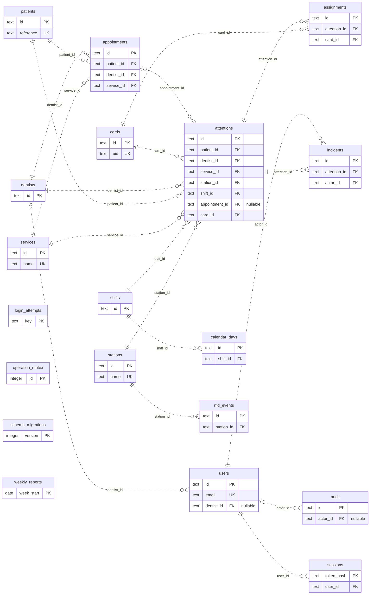
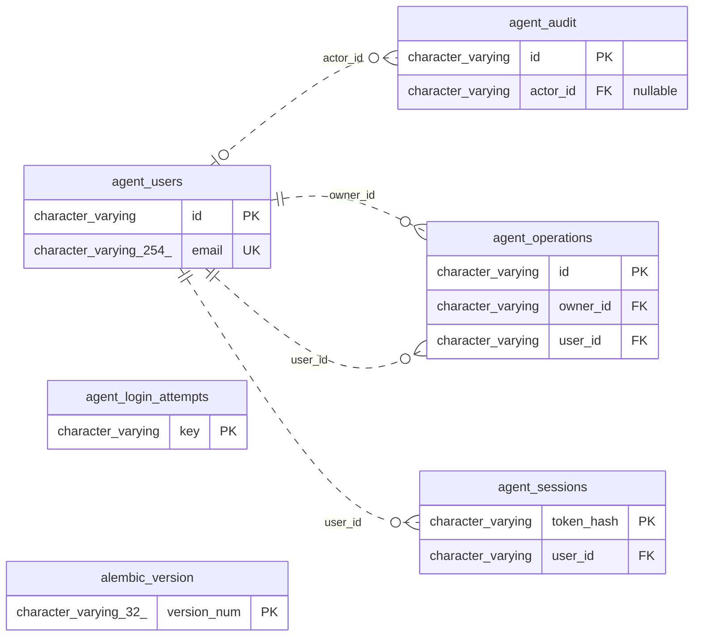

# Diagramas entidad–relación y modelos relacionales

DentalRisk y Agente IA · PostgreSQL · Esquema verificado el 3 de noviembre de 2026.

Son dos bases independientes. No existen claves foráneas entre ellas. Este documento describe el esquema implementado, no un modelo propuesto.

**Actualización del 9 de noviembre de 2026:** esta es una fotografía histórica. La instalación local ya une ambos servicios en la base `dentalrisk`; `agent_users` se integró a `users` y las referencias de las tablas `agent_*` apuntan a esa tabla. Consultar `docs/arquitectura/003-base-compartida.md` para el diseño vigente.

## Convenciones

**PK:** clave primaria. **FK:** clave foránea. **UK:** unicidad de una columna. **?**: admite NULL. Las restricciones UNIQUE compuestas y los índices únicos parciales se detallan aparte.

En los diagramas, `||` significa exactamente uno; `o|`, cero o uno; `o{`, cero o muchos. Las líneas punteadas son relaciones no identificadoras: la FK no forma parte de la PK de la tabla hija. Los diagramas muestran las claves; el modelo relacional contiene todos los atributos.

## dentalrisk

19 tablas, incluidas las tablas técnicas de control de migraciones.

### Diagrama entidad–relación

### Modelo relacional

#### appointments

`appointments(id [PK], patient_id [FK], dentist_id [FK], service_id [FK], starts_at, ends_at, status)`

| Atributo | Tipo PostgreSQL | Admite NULL | Valor por defecto en BD |
|---|---|---|---|
| `id` | `text` | No | — |
| `patient_id` | `text` | No | — |
| `dentist_id` | `text` | No | — |
| `service_id` | `text` | No | — |
| `starts_at` | `timestamp with time zone` | No | — |
| `ends_at` | `timestamp with time zone` | No | — |
| `status` | `text` | No | `'SCHEDULED'::text` |

**Claves y restricciones**

- `CHECK ((ends_at > starts_at))`

- `CHECK ((status = ANY (ARRAY['SCHEDULED'::text, 'CANCELLED'::text, 'ATTENDED'::text])))`

- `FOREIGN KEY (dentist_id) REFERENCES dentists(id)`

- `FOREIGN KEY (patient_id) REFERENCES patients(id)`

- `FOREIGN KEY (service_id) REFERENCES services(id)`

- `PRIMARY KEY (id)`

#### assignments

`assignments(id [PK], attention_id [FK], card_id [FK], assigned_at, released_at?)`

| Atributo | Tipo PostgreSQL | Admite NULL | Valor por defecto en BD |
|---|---|---|---|
| `id` | `text` | No | — |
| `attention_id` | `text` | No | — |
| `card_id` | `text` | No | — |
| `assigned_at` | `timestamp with time zone` | No | `now()` |
| `released_at` | `timestamp with time zone` | Sí | — |

**Claves y restricciones**

- `FOREIGN KEY (attention_id) REFERENCES attentions(id)`

- `FOREIGN KEY (card_id) REFERENCES cards(id)`

- `PRIMARY KEY (id)`

- Índice único parcial: `CREATE UNIQUE INDEX current_assignment ON public.assignments USING btree (card_id) WHERE (released_at IS NULL)`

#### attentions

`attentions(id [PK], patient_id [FK], dentist_id [FK], service_id [FK], station_id [FK], shift_id [FK], appointment_id [FK]?, card_id [FK], price_cents, status, started_at?, ended_at?, released_at?, created_at)`

| Atributo | Tipo PostgreSQL | Admite NULL | Valor por defecto en BD |
|---|---|---|---|
| `id` | `text` | No | — |
| `patient_id` | `text` | No | — |
| `dentist_id` | `text` | No | — |
| `service_id` | `text` | No | — |
| `station_id` | `text` | No | — |
| `shift_id` | `text` | No | — |
| `appointment_id` | `text` | Sí | — |
| `card_id` | `text` | No | — |
| `price_cents` | `bigint` | No | — |
| `status` | `text` | No | `'PENDING'::text` |
| `started_at` | `timestamp with time zone` | Sí | — |
| `ended_at` | `timestamp with time zone` | Sí | — |
| `released_at` | `timestamp with time zone` | Sí | — |
| `created_at` | `timestamp with time zone` | No | `now()` |

**Claves y restricciones**

- `CHECK (((ended_at IS NULL) OR ((started_at IS NOT NULL) AND (ended_at >= started_at))))`

- `CHECK (((status <> 'COMPLETED'::text) OR ((started_at IS NOT NULL) AND (ended_at IS NOT NULL))))`

- `CHECK ((price_cents >= 0))`

- `CHECK ((status = ANY (ARRAY['PENDING'::text, 'IN_PROGRESS'::text, 'COMPLETED'::text, 'CANCELLED'::text, 'INCIDENT'::text])))`

- `FOREIGN KEY (appointment_id) REFERENCES appointments(id)`

- `FOREIGN KEY (card_id) REFERENCES cards(id)`

- `FOREIGN KEY (dentist_id) REFERENCES dentists(id)`

- `FOREIGN KEY (patient_id) REFERENCES patients(id)`

- `FOREIGN KEY (service_id) REFERENCES services(id)`

- `FOREIGN KEY (shift_id) REFERENCES shifts(id)`

- `FOREIGN KEY (station_id) REFERENCES stations(id)`

- `PRIMARY KEY (id)`

- Índice único parcial: `CREATE UNIQUE INDEX active_appointment ON public.attentions USING btree (appointment_id) WHERE (status = ANY (ARRAY['PENDING'::text, 'IN_PROGRESS'::text]))`

- Índice único parcial: `CREATE UNIQUE INDEX active_card ON public.attentions USING btree (card_id) WHERE (released_at IS NULL)`

- Índice único parcial: `CREATE UNIQUE INDEX active_dentist ON public.attentions USING btree (dentist_id) WHERE (status = 'IN_PROGRESS'::text)`

- Índice único parcial: `CREATE UNIQUE INDEX active_station ON public.attentions USING btree (station_id) WHERE (status = 'IN_PROGRESS'::text)`

#### audit

`audit(id [PK], actor_id [FK]?, action, entity_id?, detail, created_at)`

| Atributo | Tipo PostgreSQL | Admite NULL | Valor por defecto en BD |
|---|---|---|---|
| `id` | `text` | No | — |
| `actor_id` | `text` | Sí | — |
| `action` | `text` | No | — |
| `entity_id` | `text` | Sí | — |
| `detail` | `jsonb` | No | `'{}'::jsonb` |
| `created_at` | `timestamp with time zone` | No | `now()` |

**Claves y restricciones**

- `FOREIGN KEY (actor_id) REFERENCES users(id)`

- `PRIMARY KEY (id)`

#### calendar_days

`calendar_days(id [PK], shift_id [FK], day, operated, breaks)`

| Atributo | Tipo PostgreSQL | Admite NULL | Valor por defecto en BD |
|---|---|---|---|
| `id` | `text` | No | — |
| `shift_id` | `text` | No | — |
| `day` | `date` | No | — |
| `operated` | `boolean` | No | — |
| `breaks` | `jsonb` | No | `'[]'::jsonb` |

**Claves y restricciones**

- `FOREIGN KEY (shift_id) REFERENCES shifts(id)`

- `PRIMARY KEY (id)`

- `UNIQUE (shift_id, day)`

#### cards

`cards(id [PK], uid, status)`

| Atributo | Tipo PostgreSQL | Admite NULL | Valor por defecto en BD |
|---|---|---|---|
| `id` | `text` | No | — |
| `uid` | `text` | No | — |
| `status` | `text` | No | `'AVAILABLE'::text` |

**Claves y restricciones**

- `CHECK ((status = ANY (ARRAY['AVAILABLE'::text, 'ASSIGNED'::text, 'BLOCKED'::text])))`

- `PRIMARY KEY (id)`

- `UNIQUE (uid)`

#### dentists

`dentists(id [PK], name, specialty, active)`

| Atributo | Tipo PostgreSQL | Admite NULL | Valor por defecto en BD |
|---|---|---|---|
| `id` | `text` | No | — |
| `name` | `text` | No | — |
| `specialty` | `text` | No | `''::text` |
| `active` | `boolean` | No | `true` |

**Claves y restricciones**

- `PRIMARY KEY (id)`

#### incidents

`incidents(id [PK], attention_id [FK], actor_id [FK], kind, reason, before_value, after_value, created_at)`

| Atributo | Tipo PostgreSQL | Admite NULL | Valor por defecto en BD |
|---|---|---|---|
| `id` | `text` | No | — |
| `attention_id` | `text` | No | — |
| `actor_id` | `text` | No | — |
| `kind` | `text` | No | — |
| `reason` | `text` | No | — |
| `before_value` | `jsonb` | No | — |
| `after_value` | `jsonb` | No | — |
| `created_at` | `timestamp with time zone` | No | `now()` |

**Claves y restricciones**

- `FOREIGN KEY (actor_id) REFERENCES users(id)`

- `FOREIGN KEY (attention_id) REFERENCES attentions(id)`

- `PRIMARY KEY (id)`

#### login_attempts

`login_attempts(key [PK], failures, blocked_until?, updated_at)`

| Atributo | Tipo PostgreSQL | Admite NULL | Valor por defecto en BD |
|---|---|---|---|
| `key` | `text` | No | — |
| `failures` | `integer` | No | `0` |
| `blocked_until` | `timestamp with time zone` | Sí | — |
| `updated_at` | `timestamp with time zone` | No | `now()` |

**Claves y restricciones**

- `PRIMARY KEY (key)`

#### operation_mutex

`operation_mutex(id [PK])`

| Atributo | Tipo PostgreSQL | Admite NULL | Valor por defecto en BD |
|---|---|---|---|
| `id` | `integer` | No | — |

**Claves y restricciones**

- `CHECK ((id = 1))`

- `PRIMARY KEY (id)`

#### patients

`patients(id [PK], name, reference, active)`

| Atributo | Tipo PostgreSQL | Admite NULL | Valor por defecto en BD |
|---|---|---|---|
| `id` | `text` | No | — |
| `name` | `text` | No | — |
| `reference` | `text` | No | — |
| `active` | `boolean` | No | `true` |

**Claves y restricciones**

- `PRIMARY KEY (id)`

- `UNIQUE (reference)`

#### rfid_events

`rfid_events(id [PK], station_id [FK], uid, occurred_at, response)`

| Atributo | Tipo PostgreSQL | Admite NULL | Valor por defecto en BD |
|---|---|---|---|
| `id` | `text` | No | — |
| `station_id` | `text` | No | — |
| `uid` | `text` | No | — |
| `occurred_at` | `timestamp with time zone` | No | — |
| `response` | `jsonb` | No | — |

**Claves y restricciones**

- `FOREIGN KEY (station_id) REFERENCES stations(id)`

- `PRIMARY KEY (id)`

#### schema_migrations

`schema_migrations(version [PK], applied_at)`

| Atributo | Tipo PostgreSQL | Admite NULL | Valor por defecto en BD |
|---|---|---|---|
| `version` | `integer` | No | — |
| `applied_at` | `timestamp with time zone` | No | `now()` |

**Claves y restricciones**

- `PRIMARY KEY (version)`

#### services

`services(id [PK], name, price_cents, active)`

| Atributo | Tipo PostgreSQL | Admite NULL | Valor por defecto en BD |
|---|---|---|---|
| `id` | `text` | No | — |
| `name` | `text` | No | — |
| `price_cents` | `bigint` | No | — |
| `active` | `boolean` | No | `true` |

**Claves y restricciones**

- `CHECK ((price_cents >= 0))`

- `PRIMARY KEY (id)`

- `UNIQUE (name)`

#### sessions

`sessions(token_hash [PK], user_id [FK], csrf, expires_at, operation_until?)`

| Atributo | Tipo PostgreSQL | Admite NULL | Valor por defecto en BD |
|---|---|---|---|
| `token_hash` | `text` | No | — |
| `user_id` | `text` | No | — |
| `csrf` | `text` | No | — |
| `expires_at` | `timestamp with time zone` | No | — |
| `operation_until` | `timestamp with time zone` | Sí | — |

**Claves y restricciones**

- `FOREIGN KEY (user_id) REFERENCES users(id)`

- `PRIMARY KEY (token_hash)`

#### shifts

`shifts(id [PK], name, weekday, start_time, end_time, active)`

| Atributo | Tipo PostgreSQL | Admite NULL | Valor por defecto en BD |
|---|---|---|---|
| `id` | `text` | No | — |
| `name` | `text` | No | — |
| `weekday` | `integer` | No | — |
| `start_time` | `time without time zone` | No | — |
| `end_time` | `time without time zone` | No | — |
| `active` | `boolean` | No | `true` |

**Claves y restricciones**

- `CHECK ((end_time > start_time))`

- `CHECK (((weekday >= 0) AND (weekday <= 6)))`

- `PRIMARY KEY (id)`

#### stations

`stations(id [PK], name, token_hash?, active)`

| Atributo | Tipo PostgreSQL | Admite NULL | Valor por defecto en BD |
|---|---|---|---|
| `id` | `text` | No | — |
| `name` | `text` | No | — |
| `token_hash` | `text` | Sí | — |
| `active` | `boolean` | No | `true` |

**Claves y restricciones**

- `PRIMARY KEY (id)`

- `UNIQUE (name)`

#### users

`users(id [PK], email, name, password_hash, role, dentist_id [FK]?, active)`

| Atributo | Tipo PostgreSQL | Admite NULL | Valor por defecto en BD |
|---|---|---|---|
| `id` | `text` | No | — |
| `email` | `text` | No | — |
| `name` | `text` | No | — |
| `password_hash` | `text` | No | — |
| `role` | `text` | No | — |
| `dentist_id` | `text` | Sí | — |
| `active` | `boolean` | No | `true` |

**Claves y restricciones**

- `CHECK (((role <> 'DENTIST'::text) OR (dentist_id IS NOT NULL)))`

- `CHECK ((role = ANY (ARRAY['ADMIN'::text, 'RECEPTION'::text, 'DENTIST'::text, 'SUPPORT'::text])))`

- `FOREIGN KEY (dentist_id) REFERENCES dentists(id)`

- `PRIMARY KEY (id)`

- `UNIQUE (email)`

#### weekly_reports

`weekly_reports(week_start [PK], payload, generated_at)`

| Atributo | Tipo PostgreSQL | Admite NULL | Valor por defecto en BD |
|---|---|---|---|
| `week_start` | `date` | No | — |
| `payload` | `jsonb` | No | — |
| `generated_at` | `timestamp with time zone` | No | `now()` |

**Claves y restricciones**

- `PRIMARY KEY (week_start)`

## dentalrisk_agent

6 tablas, incluidas las tablas técnicas de control de migraciones.

### Diagrama entidad–relación

### Modelo relacional

#### agent_audit

`agent_audit(id [PK], actor_id [FK]?, action, entity_id?, created_at)`

| Atributo | Tipo PostgreSQL | Admite NULL | Valor por defecto en BD |
|---|---|---|---|
| `id` | `character varying` | No | — |
| `actor_id` | `character varying` | Sí | — |
| `action` | `character varying(64)` | No | — |
| `entity_id` | `character varying` | Sí | — |
| `created_at` | `timestamp with time zone` | No | — |

**Claves y restricciones**

- `FOREIGN KEY (actor_id) REFERENCES agent_users(id)`

- `PRIMARY KEY (id)`

#### agent_login_attempts

`agent_login_attempts(key [PK], failures, blocked_until?)`

| Atributo | Tipo PostgreSQL | Admite NULL | Valor por defecto en BD |
|---|---|---|---|
| `key` | `character varying` | No | — |
| `failures` | `integer` | No | — |
| `blocked_until` | `timestamp with time zone` | Sí | — |

**Claves y restricciones**

- `PRIMARY KEY (key)`

#### agent_operations

`agent_operations(id [PK], owner_id [FK], user_id [FK], kind, request_hash, created_at)`

| Atributo | Tipo PostgreSQL | Admite NULL | Valor por defecto en BD |
|---|---|---|---|
| `id` | `character varying` | No | — |
| `owner_id` | `character varying` | No | — |
| `user_id` | `character varying` | No | — |
| `kind` | `character varying(32)` | No | — |
| `request_hash` | `character varying` | No | — |
| `created_at` | `timestamp with time zone` | No | — |

**Claves y restricciones**

- `FOREIGN KEY (owner_id) REFERENCES agent_users(id)`

- `FOREIGN KEY (user_id) REFERENCES agent_users(id)`

- `PRIMARY KEY (id)`

#### agent_sessions

`agent_sessions(token_hash [PK], user_id [FK], expires_at)`

| Atributo | Tipo PostgreSQL | Admite NULL | Valor por defecto en BD |
|---|---|---|---|
| `token_hash` | `character varying` | No | — |
| `user_id` | `character varying` | No | — |
| `expires_at` | `timestamp with time zone` | No | — |

**Claves y restricciones**

- `FOREIGN KEY (user_id) REFERENCES agent_users(id)`

- `PRIMARY KEY (token_hash)`

#### agent_users

`agent_users(id [PK], name, email, password_hash, role, dentist_id?, active, profile_object_key?, created_at)`

| Atributo | Tipo PostgreSQL | Admite NULL | Valor por defecto en BD |
|---|---|---|---|
| `id` | `character varying` | No | — |
| `name` | `character varying(120)` | No | — |
| `email` | `character varying(254)` | No | — |
| `password_hash` | `character varying` | No | — |
| `role` | `character varying(16)` | No | — |
| `dentist_id` | `character varying(64)` | Sí | — |
| `active` | `boolean` | No | — |
| `profile_object_key` | `character varying` | Sí | — |
| `created_at` | `timestamp with time zone` | No | — |

**Claves y restricciones**

- `CHECK ((((role)::text <> 'DENTIST'::text) OR (dentist_id IS NOT NULL)))`

- `CHECK (((role)::text = ANY ((ARRAY['ADMIN'::character varying, 'RECEPTION'::character varying, 'DENTIST'::character varying, 'SUPPORT'::character varying])::text[])))`

- `PRIMARY KEY (id)`

- `CREATE UNIQUE INDEX agent_users_pkey ON public.agent_users USING btree (id)`

- `CREATE UNIQUE INDEX ix_agent_users_email ON public.agent_users USING btree (email)`

#### alembic_version

`alembic_version(version_num [PK])`

| Atributo | Tipo PostgreSQL | Admite NULL | Valor por defecto en BD |
|---|---|---|---|
| `version_num` | `character varying(32)` | No | — |

**Claves y restricciones**

- `PRIMARY KEY (version_num)`

## Interpretación y límites

- `agent_users.dentist_id` es una referencia externa; no tiene FK hacia `dentists`. No hay relación SQL entre las bases.

- `profile_object_key` guarda la clave del archivo en MinIO. Las imágenes no se almacenan en PostgreSQL.

- `rfid_events.uid` no tiene FK hacia `cards.uid`; permite registrar lecturas de tarjetas desconocidas.

- `audit.entity_id` y `agent_audit.entity_id` son referencias lógicas sin FK.

- Una cita puede tener varias atenciones históricas. El índice parcial permite solo una atención PENDING o IN_PROGRESS por cita; no es una relación 1:1 permanente.

- Una tarjeta puede tener varias atenciones históricas, pero solo una sin liberar. Una estación y un dentista solo pueden tener una atención IN_PROGRESS.

- `calendar_days` tiene unicidad compuesta `(shift_id, day)`. No significa que cada columna sea única por separado.

- `users.dentist_id` es opcional en general y obligatorio para el rol DENTIST. No tiene UNIQUE: el esquema permite varias cuentas asociadas al mismo dentista.

- `operation_mutex`, `schema_migrations` y `alembic_version` son tablas técnicas. Las tablas sin conectores no tienen claves foráneas declaradas.

- Los valores por defecto mostrados corresponden al servidor. Los valores asignados por el código Python no son necesariamente DEFAULT de PostgreSQL.

- En todas las FK del esquema actual se aplica NO ACTION por defecto para borrado y actualización; no hay cascadas declaradas.
